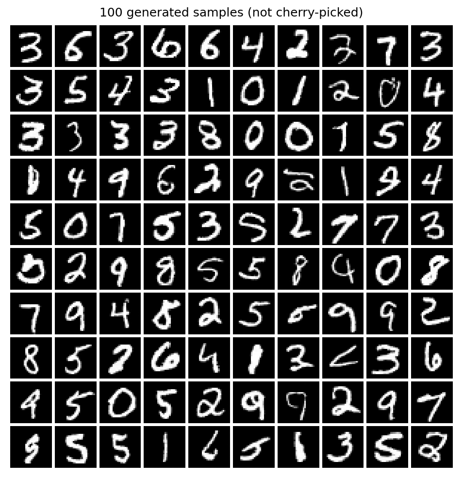
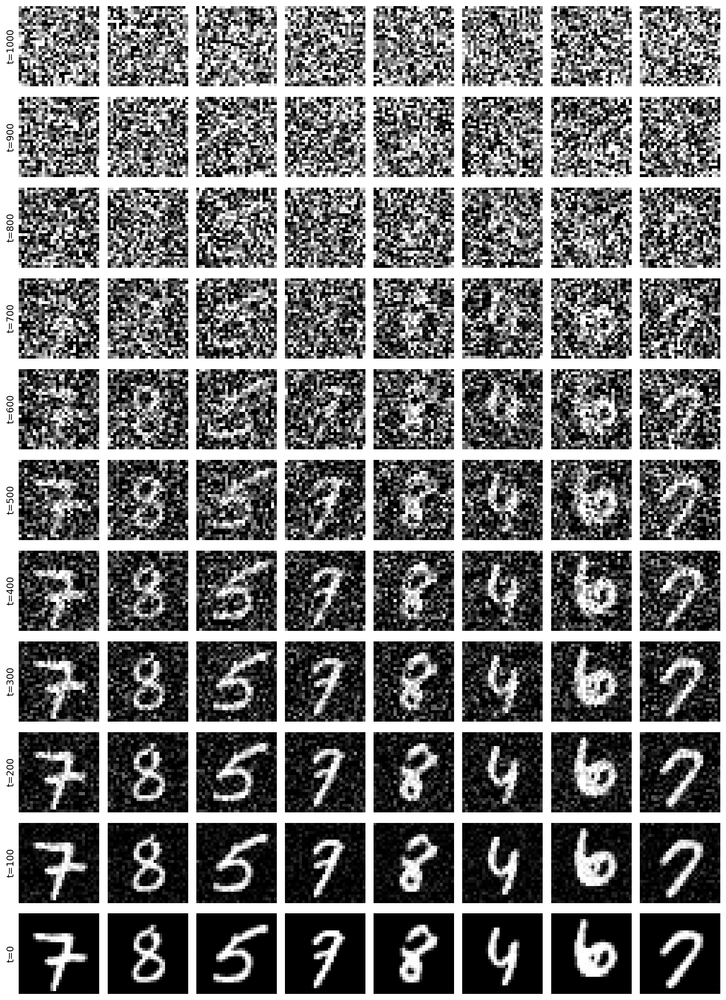
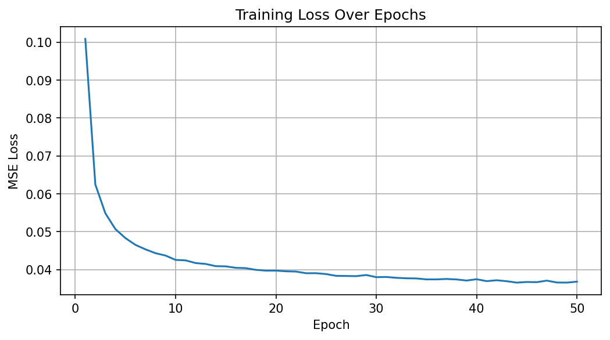
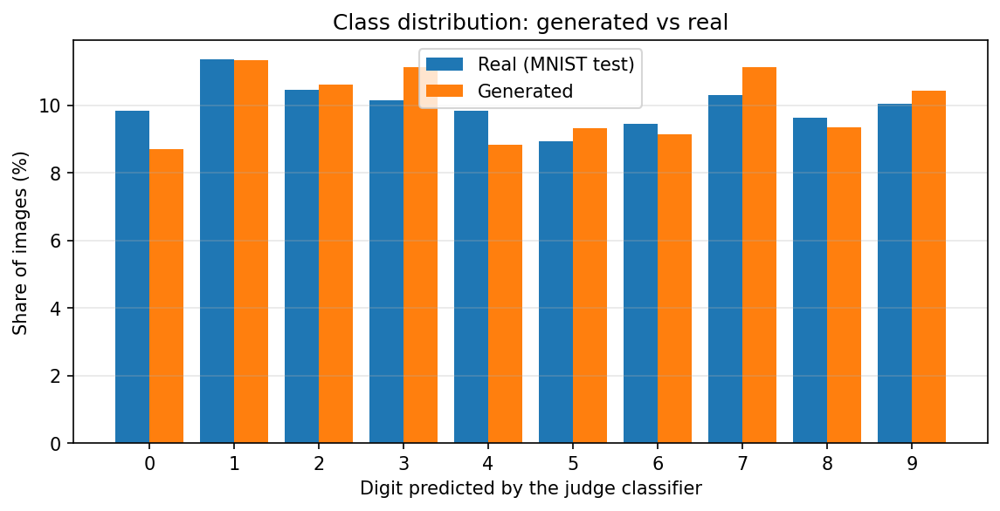
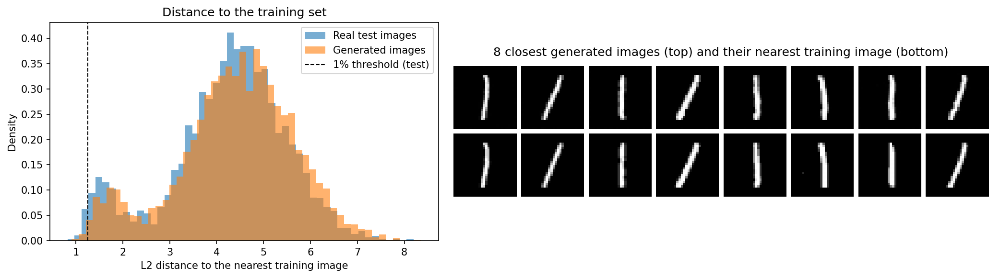

# Diffusion Image Generator


> **Generative AI is changing fast, and image generation is one of its most striking results.** Type a sentence into Midjourney, DALL·E or Stable Diffusion, and a few seconds later you get an image that never existed before. So how can a neural network create an image out of nothing?

Behind most of these tools lies the same idea: **diffusion models**. The model never learns to draw. It learns to **remove noise**. Start from pure random noise, remove a little of it at each step, and after hundreds of steps an image appears.

This approach was made practical by the **Denoising Diffusion Probabilistic Model (DDPM)** of [Ho et al. (2020)](https://arxiv.org/abs/2006.11239), the foundation of today's image generators. This project implements DDPM **from scratch in PyTorch**, trains it on handwritten digits (MNIST), and measures how good its images really are.



*100 digits generated from pure noise: consecutive samples, not cherry-picked. They are new digits, not copies of training images ([see the memorization test](#evaluation)).*

## Results

Measured on 5,000 generated images. Each metric is compared with the same metric computed on **real** MNIST images, which gives the best score reachable under the same conditions.

| Metric | Generated | Real images | What it measures |
| --- | --- | --- | --- |
| **FID** (lower is better) | **3.60** | 2.20 | Distance between generated and real image distributions |
| Recognizable digits (judge confidence ≥ 0.9) | **88.2%** | 97.2% | Quality |
| Inception Score with a MNIST judge (max 10) | **8.88** | 9.63 | Quality and diversity |
| Class balance, normalized entropy (max 1) | **0.998** | 0.999 | Diversity: no mode collapse |
| Samples closer to the training set than 99% of real test images | **0.34%** | ~1% expected | Memorization |

All metrics are in [`results/metrics.json`](results/metrics.json).

## How it works

**Forward process.** Gaussian noise is added to an image $x_0$ over $T = 1000$ steps. Any noisy version $x_t$ can be sampled in one step:

$$
x_t = \sqrt{\bar{\alpha}_t}\, x_0 + \sqrt{1 - \bar{\alpha}_t}\, \epsilon, \qquad \epsilon \sim \mathcal{N}(0, I)
$$

**Training.** A U-Net $\epsilon_\theta$ learns to predict the noise that was added, with the simplified DDPM loss:

$$
L = \mathbb{E}_{x_0, t, \epsilon} \left[ \| \epsilon - \epsilon_\theta(x_t, t) \|^2 \right]
$$

**Generation.** Starting from pure noise $x_T$, the model removes noise step by step, from $t = 1000$ down to $t = 0$:

$$
x_{t-1} = \frac{1}{\sqrt{\alpha_t}} \left( x_t - \frac{\beta_t}{\sqrt{1 - \bar{\alpha}_t}}\, \epsilon_\theta(x_t, t) \right) + \sqrt{\tilde{\beta}_t}\, z, \qquad z \sim \mathcal{N}(0, I)
$$



## Model and training

- **U-Net noise predictor** (16.5 M parameters): residual blocks, sinusoidal time embeddings, and multi-head self-attention at the 7×7 bottleneck.
- **Cosine noise schedule** from [Nichol & Dhariwal (2021)](https://arxiv.org/abs/2102.09672), which adds noise more gradually than the linear schedule of the original paper.
- **Training:** 50 epochs on the 60,000 MNIST training images, batch size 128, AdamW (learning rate 1e-4) with cosine decay, mixed precision. It takes 49 minutes on a Tesla T4.
- **Generation:** 1,000 denoising steps per image, about 0.34 s per image on a T4.



## Evaluation

The model is **unconditional**: it generates a digit without any target image. Pixel-to-pixel metrics such as SSIM or PSNR therefore do not apply, because there is no reference image to compare with. A generative model is judged on the **distribution** of what it produces, so three questions are tested.

**1. Do the samples look like real digits?** The [FID](https://arxiv.org/abs/1706.08500) compares InceptionV3 features of generated and real images. The score of 3.60 is close to the 2.20 obtained between two sets of real images.

**2. Are all digits generated?** A separate CNN trained on MNIST (99.15% test accuracy) labels every sample. All ten digits appear in 8.7% to 11.3% of the samples, close to the real distribution.



**3. Does the model copy its training data?** For each sample, the closest training image is found by pixel distance. Generated images are as far from the training set as unseen real test images are. The closest cases are simple vertical "1" strokes, which naturally look alike.



## Limitations

- About 12% of the samples are less clearly formed than real digits (88.2% recognized with high confidence, against 97.2% for real images).
- Generation is slow: each image needs 1,000 passes through the U-Net.
- The FID uses an InceptionV3 network trained on natural photos. It is only meaningful here relative to the real-image reference, and cannot be compared with FID values reported on other datasets.
- MNIST images are small (28×28) and grayscale.

## Repository structure

```
├── notebooks/
│   └── diffusion_image_generator.ipynb   # full workflow with outputs (explanations in French)
├── results/
│   ├── metrics.json
│   ├── training_log.json                 # loss per epoch, training time
│   └── figures/
└── requirements.txt
```

## Usage

Open `notebooks/diffusion_image_generator.ipynb` in Google Colab with a GPU and run all cells. MNIST is downloaded automatically. Checkpoints and generated images are saved to Google Drive, so the run resumes where it stopped after a disconnection.

To run it locally:

```bash
pip install -r requirements.txt
jupyter notebook notebooks/diffusion_image_generator.ipynb
```

## References

- Ho, J., Jain, A., & Abbeel, P. (2020). [Denoising Diffusion Probabilistic Models](https://arxiv.org/abs/2006.11239). *NeurIPS 2020*.
- Nichol, A., & Dhariwal, P. (2021). [Improved Denoising Diffusion Probabilistic Models](https://arxiv.org/abs/2102.09672). *ICML 2021*.
- Heusel, M., et al. (2017). [GANs Trained by a Two Time-Scale Update Rule Converge to a Local Nash Equilibrium](https://arxiv.org/abs/1706.08500). *NeurIPS 2017*.

## Author

**Yassine Houari** · [LinkedIn](https://www.linkedin.com/in/yassine-houari-/)
